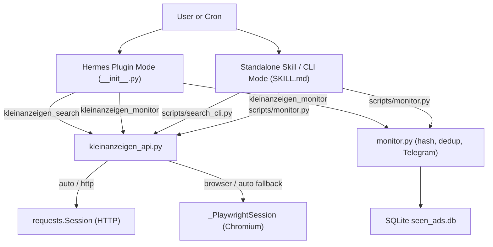

# Architecture

This document describes the technical design of **hermes-kleinanzeigen**, a dual **Hermes Agent plugin** and **standalone skill** for searching and monitoring classifieds listings on `kleinanzeigen.de`.

Related documentation:
- [README.md](../README.md) — installation, CLI flags, plugin tools, and usage examples
- [skills/kleinanzeigen/SKILL.md](../skills/kleinanzeigen/SKILL.md) — Hermes Agent skill instructions and procedure
- [CONTRIBUTING.md](../CONTRIBUTING.md) — development setup, validation tools, and security/anti-bot rules
- [CHANGELOG.md](../CHANGELOG.md) — version history

---

## 1. Dual Plugin + Standalone Skill Architecture

The repository is structured so a single codebase supports two installation models without code duplication:

1. **Native Hermes Plugin** (via root [plugin.yaml](../plugin.yaml) and [`__init__.py`](../__init__.py)):
   - Installed via `hermes plugins install`.
   - Declares `manifest_version: 2`, `kind: standalone`, and runtime `pip_dependencies` in `plugin.yaml`.
   - Exposes `kleinanzeigen_search` and `kleinanzeigen_monitor` tools directly to the Hermes model and registers the bundled `kleinanzeigen` skill (`skills/kleinanzeigen/SKILL.md`) via `ctx.register_skill(...)`.
2. **Standalone Hermes Skill** (via [`skills/kleinanzeigen/`](../skills/kleinanzeigen/)):
   - Installed via `hermes skills install clockwork-dev/hermes-kleinanzeigen/kleinanzeigen` or copied directly into a Hermes `skills/` directory.
   - Ships its own [`SKILL.md`](../skills/kleinanzeigen/SKILL.md), [`requirements.txt`](../skills/kleinanzeigen/requirements.txt), [`LICENSE`](../skills/kleinanzeigen/LICENSE), and self-contained [`scripts/`](../skills/kleinanzeigen/scripts/).
   - Intentionally excludes scaffolding files forbidden by Hermes's `skill_linter` (`README.md`, `CHANGELOG.md`, `install.sh`, `.env`, `.env.example`, `.gitignore`) inside `skills/kleinanzeigen/`.



### Packaging & Cross-Context Imports

- [`pyproject.toml`](../pyproject.toml) uses `setuptools.build_meta` (`setuptools>=77`) with `packages = []` and `py-modules = []` so `pip install -e ".[dev]"` or `pip install ".[browser]"` installs dependencies cleanly without polluting site-packages with a top-level `skills` package. `[tool.pytest.ini_options]` sets `testpaths = ["tests"]` and `pythonpath = ["."]`.
- **Plugin imports** (`__init__.py`): `_load_api()` and `_load_monitor()` use package-relative imports (`from .skills.kleinanzeigen.scripts import ...`) when `__package__` is populated by Hermes's plugin loader, and fall back to root imports (`from skills.kleinanzeigen.scripts import ...`) when imported directly in tests.
- **Standalone CLI imports** (`search_cli.py` and `monitor.py`): check `if __package__:` first; when invoked as a direct script (`python scripts/search_cli.py ...`), they prepend `_SCRIPT_DIR` (`scripts/`) and `_SKILL_ROOT` (`skills/kleinanzeigen/`) to `sys.path` and import `kleinanzeigen_api` / `search_cli` directly (with a `scripts.*` fallback).

---

## 2. Plugin Manifest & Entrypoint (`plugin.yaml`, `__init__.py`, `pyproject.toml`)

### `plugin.yaml`

| Field | Value / Purpose |
| --- | --- |
| `manifest_version` | `2` |
| `name` | `kleinanzeigen` |
| `version` | `"1.0.0"` |
| `kind` | `standalone` |
| `license` | `MIT` |
| `requires_hermes` | `">=0.20.0"` |
| `provides_tools` | `["kleinanzeigen_search", "kleinanzeigen_monitor"]` |
| `pip_dependencies` | `requests>=2.31,<3`, `beautifulsoup4>=4.12,<5`, `fake-useragent>=1.4,<3` |
| `optional_env` | `KLEINANZEIGEN_DB_PATH`, `BROWSER_CDP_URL`, `BROWSER_DISABLE_RESOURCE_BLOCKING`, `BROWSER_EXECUTABLE_PATH` (all `password: false`) |

`entry_point` and `skills` are intentionally omitted from `plugin.yaml` because Hermes loads root `__init__.py` directly and `register(ctx)` registers the bundled skill dynamically.

### `__init__.py` Registration & Handlers

`register(ctx)` registers:
1. **`kleinanzeigen_search`** (`toolset="kleinanzeigen"`, schema `SEARCH_SCHEMA`, handler `_handle_search`)
2. **`kleinanzeigen_monitor`** (`toolset="kleinanzeigen"`, schema `MONITOR_SCHEMA`, handler `_handle_monitor`)
3. **Bundled skill `kleinanzeigen`**: calls `ctx.register_skill("kleinanzeigen", _SKILL_MD_PATH, description=_SKILL_DESCRIPTION, frontmatter={"name": "kleinanzeigen", "description": _SKILL_DESCRIPTION, "platforms": ["linux", "macos", "windows"]})` when `skills/kleinanzeigen/SKILL.md` exists.

Both schemas set `required: ["query"]` and `additionalProperties: false`, constraining `radius` to `_ALLOWED_RADII = [0, 5, 10, 20, 30, 50, 100, 150, 200]`, `fetch_mode` to `_ALLOWED_FETCH_MODES = ["auto", "http", "browser"]`, and (on monitor) `format` to `_ALLOWED_FORMATS = ["json", "telegram"]`.

- `_extract_search_kwargs()` converts `fetch_mode` into `use_playwright_fallback = (fetch_mode != "http")` and verifies `include_top_ads` is a `bool`.
- `_handle_search()` returns JSON with `ok: true`, `query`, `postal_code`, `radius`, `fetch_mode`, `count`, and `listings`.
- `_handle_monitor()` additionally validates `format` and `dry_run`, resolves the SQLite DB via `_resolve_plugin_db_path()`, calls `compute_query_hash()` and `filter_and_record_listings()`, and returns `ok: true`, `format`, `dry_run`, `db_path`, `query_hash`, `total_fetched`, `new_count`, `listings`, and (when `format == "telegram"`) `message` (empty string `""` when `new_listings` is empty).
- `_error_payload()` maps exceptions to structured JSON (`ok: false`) with deterministic `error_type` values:
  - `ValidationError` -> `"validation_error"`
  - `KleinanzeigenBlockedError` -> `"blocked"` (plus `status_code`, `url`, `reason`)
  - `KleinanzeigenError` -> `"kleinanzeigen_error"`
  - `sqlite3.Error` -> `"database_error"`
  - `OSError` -> `"io_error"`
  - Any other `Exception` -> `"unexpected_error"`

---

## 3. Core Engine (`skills/kleinanzeigen/scripts/kleinanzeigen_api.py`)

Public symbols exported via `__all__` (and re-exported by `skills/kleinanzeigen/scripts/__init__.py`):
- Constants: `ALLOWED_RADII`, `BASE_URL`, `BLOCKED_RESOURCE_TYPES`, `BLOCKED_URL_PATTERNS`
- Exceptions: `KleinanzeigenError`, `ValidationError`, `KleinanzeigenBlockedError`
- Functions: `resolve_location_id`, `build_search_url`, `parse_breadcrumb`, `parse_listings_html`, `search_listings`

### Input Validation

- `_validate_search_params()`:
  - `query`: must be a non-empty `str` after `.strip()`.
  - `postal_code`: optional `str`; `.strip()` must match `_PLZ_PATTERN = re.compile(r"[0-9]{5}")` (`fullmatch`).
  - `radius`: if provided, requires `postal_code`; must be an `int` (excluding `bool`) in `ALLOWED_RADII = (0, 5, 10, 20, 30, 50, 100, 150, 200)`.
  - `min_price`, `max_price`: optional `int >= 0` (excluding `bool`); enforces `min_price <= max_price`.
  - `limit`, `page`: must be `int >= 1` (excluding `bool`).
- `_validate_fetch_options()`:
  - `fetch_mode` must be `"auto"`, `"http"`, or `"browser"`.
  - `use_playwright_fallback` must be a `bool`; passing `fetch_mode="browser"` with `use_playwright_fallback=False` raises `ValidationError`.
  - `timeout` must be a positive `int` or `float` (excluding `bool`).

### URL Builder & Location Lookup

`build_search_url(query, postal_code=None, radius=None, min_price=None, max_price=None, location_id=None, page=1)` constructs:

```text
https://www.kleinanzeigen.de[/s-preis:<min>:<max>]/s-seite:<page>?keywords=<query>[&locationStr=<plz>][&locationId=<id>][&radius=<km>]
```

- When either `min_price` or `max_price` is specified, the price path segment `/s-preis:{min}:{max}` is prepended, leaving the omitted bound empty (e.g., `/s-preis:50:` or `/s-preis::500`).
- `locationStr` carries the 5-digit PLZ directly alongside `radius` (including `radius=0`).
- `resolve_location_id(postal_code, session, headers, timeout=10.0)` provides an optional best-effort lookup against `/s-ort-empfehlungen.json?query=<plz>`, silently returning `None` on non-200 responses, blocks, invalid JSON, or network exceptions. `search_listings()` intentionally omits calling `resolve_location_id()` so every search avoids an unnecessary extra request.

### Fetch Modes, Retries, and Sequential Pagination

`search_listings(...)` supports three live fetch modes plus offline HTML parsing:

| Mode | Behavior | On Block (`403`/`429`/`503`/Challenge) |
| --- | --- | --- |
| `"auto"` (default) | Uses `requests.Session` first; if blocked and `use_playwright_fallback=True`, lazily enters `_PlaywrightSession` and keeps using it for remaining pages. | Falls back to Playwright; raises `KleinanzeigenBlockedError` if Playwright is also blocked or unavailable. |
| `"http"` | Uses `requests.Session` only (`allow_playwright=False`). | Raises `KleinanzeigenBlockedError` immediately. |
| `"browser"` | Skips `requests` preflight and opens `_PlaywrightSession` immediately. | Raises `KleinanzeigenBlockedError`. |
| `html_override` | Bypasses all network calls and passes HTML straight to `parse_listings_html()`. | N/A (offline). |

Key HTTP & retry mechanics:
- `_build_headers()` sets `Accept`, `Accept-Language: de-DE,de;q=0.9,en;q=0.8`, `Referer: https://www.kleinanzeigen.de/`, and a desktop Chrome/Edge `User-Agent` from `fake_useragent` (rejecting `_MOBILE_UA_MARKERS` and falling back to `_DEFAULT_USER_AGENT`).
- `_decode_response_text()` decodes UTF-8 bytes when `requests` falls back to `ISO-8859-1` on responses missing an explicit `charset` header.
- `_fetch_html_http()` and `_PlaywrightSession.fetch_page()` retry up to `_MAX_FETCH_RETRIES = 2` (3 total attempts) with `_retry_delay(attempt) = min((2 ** attempt) + random.uniform(0.1, 0.5), 5.0)` **only** when `_is_transient_network_error(exc)` returns `True` (timeouts, DNS/connection resets, `net::err_*`). Blocks and HTTP 4xx/5xx responses are never retried.
- **Sequential pagination**: If page 1 yields fewer than `limit` items, `parse_breadcrumb(page1_html)` inspects `#srp-breadcrumb-summary, .breadcrump-summary` against `(\d+(?:\.\d+)*)\s*-\s*(\d+(?:\.\d+)*)\s+von\s+(\d+(?:\.\d+)*)` and computes `math.ceil(total / page_end)` when `page_start == 1`. Pages `2..min(total_pages, _MAX_PAGINATION_PAGES)` (capped at `_MAX_PAGINATION_PAGES = 10`) are fetched sequentially with `_PAGE_DELAY_SECONDS = 2.0` delay, deduplicating by `id` and stopping early on `limit` or empty pages.

### Playwright Resource Blocking & Chromium Discovery

`_PlaywrightSession` manages a reusable synchronous Playwright browser (`sync_playwright`) and context (`locale="de-DE"`, desktop `User-Agent`, `Accept-Language`, minimum timeout `_MIN_PLAYWRIGHT_TIMEOUT_MS = 60000`):

1. **CDP or Local Launch**: If `BROWSER_CDP_URL` is set, connects via `playwright.chromium.connect_over_cdp(cdp_url)`. Otherwise `_launch_chromium()` launches headless Chromium.
2. **Chromium Discovery Order** (`_launch_chromium`, `_resolve_configured_browser_executable`, `_discover_chromium_executables`):
   - First: `BROWSER_EXECUTABLE_PATH` (explicit file path or command resolved via `shutil.which`; raises `FileNotFoundError` immediately if set to a missing path).
   - Second: Default Playwright `chromium.launch(headless=True)`.
   - Third (when Playwright raises a missing-binary error per `_is_missing_browser_binary_error()`): scans `chromium-*` directories (sorted descending by numeric revision) under `$HERMES_HOME/tools` across `_hermes_home_candidates()` (`HERMES_HOME`, `%LOCALAPPDATA%\hermes` on Windows, `~/.hermes`), matching `_CHROMIUM_BIN_NAMES` (`chrome.exe`, `chrome`, `chromium.exe`, `chromium`, `chrome-headless-shell.exe`, `chrome-headless-shell`) and `_MACOS_APP_EXECUTABLES` (`Google Chrome for Testing.app`, `Chromium.app`).
   - Fourth: On non-Windows hosts, checks `/etc/hermes/chromium-executable-path`.
   - Fifth: Searches `PATH` via `shutil.which` for `_SYSTEM_CHROMIUM_COMMANDS` (`chromium`, `chromium-browser`, `google-chrome`).
3. **Resource Interception** (`_block_heavy_resources`): Registered on `context.route("**/*", ...)` unless `BROWSER_DISABLE_RESOURCE_BLOCKING=1`. Aborts requests whose `resource_type` is in `BLOCKED_RESOURCE_TYPES = frozenset({"image", "media", "font"})` or whose URL contains any substring in `BLOCKED_URL_PATTERNS = ("/liberty/", "/gdpr/", "promotion-frontend", "kameleoon", "sgtm-legacy")`. Document, script, XHR/fetch, and stylesheet requests continue normally.
4. **Per-Page Isolation**: Each `fetch_page()` opens a fresh page (`wait_until="domcontentloaded"`), closes the page in `finally`, and invokes `context.clear_cookies()` between pages.
5. **Actionable Startup Errors** (`_format_playwright_launch_error`): Distinguishes missing Chromium binaries (`playwright install chromium --only-shell`) from missing Linux OS shared libraries (`_MISSING_SHARED_LIB_MARKERS`, e.g. `libnspr4`, `libnss3`, recommending `playwright install-deps chromium`). When Playwright fallback fails in `auto` mode after an HTTP block, `_PlaywrightSession` raises `KleinanzeigenBlockedError` preserving the initial HTTP status and URL.

### Astro + BEM + `application/ld+json` Parser

`parse_listings_html(html, limit=10, *, include_top_ads=False)` supports both current Astro SSR markup and classic BEM/Tailwind cards:

- **Astro Island Metadata** (`_extract_page_ad_previews`, `_decode_astro_value`, `_parse_ad_previews`): Parses `astro-island[props]` JSON, recursively decoding Astro's `[kind, payload]` tuples (`0` -> dict, `1` -> list) to index preview objects containing `"id"` and any of `"sortingDate"`, `"topAd"`, `"appliedFeatures"`.
- **Card Selection & Filtering**: Iterates `article[data-adid]` elements, skipping empty IDs, banner placeholders (`_is_banner_card`), duplicate IDs within the page, and Top-Anzeige / highlighted ads (`_is_top_ad`) unless `include_top_ads=True`. `_is_top_ad()` checks Astro `preview["topAd"] is True`, `"TOP_AD"` in `appliedFeatures`, `is-topad` / `is-highlight` classes, `.badge-topad` / `[data-testid*='topad']`, `aria-label` / `title`, and short non-description text containing `top-anzeige`.
- **JSON-LD Fallback** (`_extract_ld_json`): Reads `script[type="application/ld+json"]` inside each `<article>` for fallback `title`/`name` and `contentUrl`/`image`.
- **Normalized 7-Key Output Schema**:
  - `id`: `article["data-adid"]`
  - `url`: `data-href` or first valid anchor matching title/listing link selectors, resolved via `urljoin(BASE_URL, ...)`.
  - `title`: BEM/test-id/heading selectors (`.aditem-main--title-line a`, `[data-testid='ad-title']`, `h2`/`h3`), skipping image-count thumbnail links containing `img` or `[data-image-container]`, falling back to `ld_json`.
  - `price`: Astro `h3 ~ div > p.font-strong`, classic `.aditem-main--middle--price-shipping--price` / `[data-testid='ad-price']` / `[class*='price']` (excluding shipping labels and `.line-through` struck-through original prices), or `_PRICE_TEXT_PATTERN` (`€`, `EUR`, `VB`, `zu verschenken`) leaf fallback.
  - `location`: `.aditem-main--top--left`, `[data-testid='ad-location']`, `.aditem-main--top` children, pre-`h3` Astro spans (`_pre_h3_location_spans`), or 5-digit PLZ leaf match; strips `Standort`/`Ort` prefixes and appends adjacent `(N km)` distance siblings (`_append_adjacent_distance`).
  - `description`: `.aditem-main--middle--description`, `[data-testid='ad-description']`, `h3 + p`, or `<p>` fallback while rejecting `_is_non_description_paragraph()` elements (`line-through`, `font-strong`, `data-dhl-promotion`, shipping/price/location/date classes, icon-flex containers) and duplicates of title/price/location.
  - `image_url`: Scans `[data-image-container] img`, `.aditem-image img`, `.imagebox img`, `[data-testid*='image'] img`, `[class*='image'] img`, `img`, prioritizing `data-src`/`data-lazy-src`, `data-srcset`/`srcset` (preferring `$_35.auto` / `$_59.auto` or highest descriptor when `src` is a `data:` URI or `$_2.auto` tiny thumbnail), `src`, and `ld_json` `contentUrl`/`image`.

### Block Detection & Strict Non-Bypass Policy

`_detect_block(status_code, html)` flags:
- Status codes in `_BLOCKED_STATUS_CODES = frozenset({403, 429, 503})`.
- Body substrings in `_HTML_BLOCK_MARKERS`:
  - `ip-bereich vorübergehend gesperrt` and `ip-bereich vor&uuml;bergehend gesperrt` (Akamai IP range block)
  - `cf-turnstile` (Cloudflare Turnstile)
  - `g-recaptcha` (reCAPTCHA)
  - `hcaptcha` (hCaptcha)
  - `verify you are human` (Human verification challenge)
  - `access denied` (Access Denied block page)
- `_CLOUDFLARE_TITLE_PATTERN` (`Just a moment...`, `Attention Required! | Cloudflare`, etc.).

The codebase strictly never clicks, solves, waits out, or bypasses CAPTCHAs, Turnstile challenges, or proof-of-work gates. Any detected block immediately raises `KleinanzeigenBlockedError`.

---

## 4. CLI Scripts (`search_cli.py` and `monitor.py`)

### `search_cli.py`

- Calls `configure_utf8_streams()` to reconfigure `sys.stdout` and `sys.stderr` to UTF-8 with `errors="replace"` on Windows consoles.
- Defines `add_search_arguments(parser)` (reused by `monitor.py`) for `query`, `--plz`, `--radius`, `--min-price`, `--max-price`, `--limit`, mutually exclusive `--browser` / `--no-browser`, `--include-top-ads`, and `--html-file`.
- `resolve_fetch_options()` maps `--browser` -> `("browser", True)`, `--no-browser` -> `("http", False)`, default -> `("auto", True)`.
- Writes JSON arrays (`ensure_ascii=False, indent=2`) to `stdout` (exit `0`), or writes concise single-line diagnostics via `report_error()` to `stderr` (exit `1`).

### `monitor.py`

Extends `add_search_arguments` with `--db`, `--format {json,telegram}`, and `--dry-run`.

#### Query Hashing & Deduplication

- `compute_query_hash(query, postal_code, radius, min_price, max_price)` computes a SHA-256 hex digest of the compact JSON array `[query.strip().lower(), (postal_code or "").strip(), radius, min_price, max_price]`.
- `limit`, `--browser`/`--no-browser` (`fetch_mode`), `--include-top-ads`, `--format`, `--dry-run`, and `--db` are excluded from the hash so switching fetch strategies or display limits preserves seen-ad state.

#### SQLite Schema & Transaction Lifecycle

```sql
CREATE TABLE IF NOT EXISTS seen_ads (
    ad_id TEXT PRIMARY KEY,
    query_hash TEXT,
    seen_at TIMESTAMP
)
```

`filter_and_record_listings()`:
1. Creates parent directories for `db_path` (unless `str(db_path) == ":memory:"`).
2. Queries existing IDs in batches of `500` (`_fetch_existing_ids()`) to remain well below SQLite's bind-parameter limit.
3. Deduplicates across both `seen_ads` and the current batch (`seen_in_batch`).
4. When `new_listings` is non-empty and `dry_run=False`, inserts `(ad_id, query_hash, seen_at)` using `INSERT OR IGNORE` with an ISO-8601 UTC timestamp (`datetime.now(timezone.utc).isoformat()`).

#### Telegram Formatting

`format_telegram_message(listings, query, postal_code=None, radius=None)`:
- Emits Russian summary header (`🔍 **Kleinanzeigen: <N> объявлений по запросу "<query>"**`) and location line (`PLZ (+radius km)`, `PLZ`, or `Вся Германия`).
- Escapes Markdown special characters `\*_`[]` via `_escape_markdown()` on user-controlled text fields.
- Encodes spaces and parentheses (`%20`, `%28`, `%29`) in URLs via `_sanitize_url()` so Markdown links remain valid.
- Truncates descriptions cleanly on word boundaries at `MAX_DESCRIPTION_LENGTH = 160` (`_truncate_text()`).
- In CLI mode (`--format telegram`), when 0 unseen listings remain, `monitor.py` leaves `stdout` empty and prints `"No new listings."` to `stderr` to prevent empty cron alerts.

---

## 5. Cross-Platform Storage & Runtime Paths

| Aspect | Native Plugin Mode (`__init__.py`) | Standalone Skill / CLI Mode (`monitor.py`, `SKILL.md`) |
| --- | --- | --- |
| **SQLite DB resolution** | 1. Explicit `db_path` arg<br>2. `KLEINANZEIGEN_DB_PATH` env var<br>3. `plugins.plugin_storage.plugin_data_dir("kleinanzeigen") / "seen_ads.db"`<br>4. `hermes_constants.get_hermes_home() / "plugin-data/kleinanzeigen/seen_ads.db"`<br>5. `$HERMES_HOME/plugin-data/kleinanzeigen/seen_ads.db`<br>6. `%LOCALAPPDATA%\hermes\plugin-data\kleinanzeigen\seen_ads.db` (Windows) or `~/.hermes/plugin-data/kleinanzeigen/seen_ads.db` (POSIX) | 1. `--db` CLI flag<br>2. `KLEINANZEIGEN_DB_PATH` env var<br>3. `~/.hermes/skills/kleinanzeigen/data/seen_ads.db` (Windows users should pass `--db "${HERMES_SKILL_DIR}/data/seen_ads.db"` or set `KLEINANZEIGEN_DB_PATH`) |
| **Skill directory** | Registered dynamically from repo's `skills/kleinanzeigen/SKILL.md` as `kleinanzeigen:kleinanzeigen` | Linux/macOS: `~/.hermes/skills/kleinanzeigen/`<br>Windows: `%LOCALAPPDATA%\hermes\skills\productivity\kleinanzeigen\` (Hermes defaults `HERMES_HOME` to `%LOCALAPPDATA%\hermes`) |
| **Python runtime** | Managed automatically by Hermes plugin installation (`pip_dependencies` in `plugin.yaml`) | `hermes pm environment kleinanzeigen ...` (isolated `uv` side env under `$HERMES_HOME/environments/kleinanzeigen/`), local `.venv`, or `uv run --with-requirements` |
| **Shell quoting** | In-process Python tool calls | Always quote `"$PY"` and `"${HERMES_SKILL_DIR}/scripts/..."` in Git Bash on Windows to preserve backslashes |
